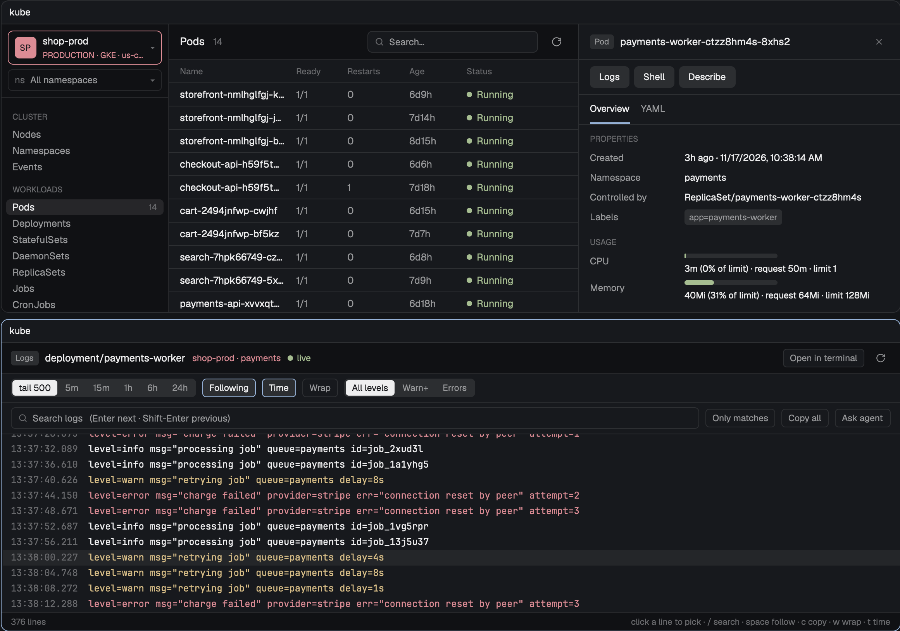

# herdr-mods

Mods for the [Herdr](https://herdr.dev) desktop app. Each folder is one mod, with its own README, `RECIPE.md` (the brief to rebuild it) and preview.

| Mod | What it does |
| --- | --- |
| [kube](kube) | An OpenLens-style Kubernetes panel: several clusters at once, 18 resource kinds, live CPU/memory, a searchable log viewer with copy and Ask agent, shells and port-forwards in Herdr terminals. Read-mostly: restart and scale behind a confirmation, no delete. |
| [topbar-actions](topbar-actions) | Review (Redline) and Kubernetes buttons at the right end of the tab bar. |



## Install one

Tell your Herdr agent:

> Read ~/.config/herdr-app/AGENTS.md, then add this mod: https://github.com/jchen0824/herdr-mods/tree/main/kube

Or copy `<mod>/mods/<name>` into `~/.config/herdr-app/mods/` and run `herdr-app check` on it; each README has the details.

## Develop

```sh
make hooks   # once: enforce Conventional Commits locally
make check   # mod structure, syntax, QuickJS rules, unit tests
```

See [CONTRIBUTING.md](CONTRIBUTING.md); coding agents start at [AGENTS.md](AGENTS.md).

## License

MIT
