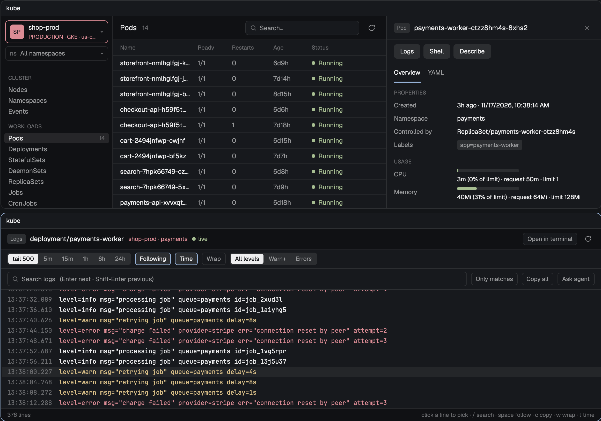

# Kubernetes for Herdr

An OpenLens-style Kubernetes panel for the [Herdr](https://herdr.dev) desktop app: browse 18 kinds of resources across one or several clusters, see live CPU and memory, read logs in a searchable viewer, and open shells and port-forwards in Herdr terminals.



## Features

- **Clusters.** Every kubeconfig context, with readable names (`gke_…_europe-west1_shop` reads "shop · GKE · europe-west1") and a coloured badge. Tick several to see their rows together, with a Cluster column. Contexts whose name contains `prod`, `production`, `prd` or `live` are marked in red.
- **Namespaces.** Pick any namespace, or all of them.
- **Resources**, grouped as in OpenLens:
  - Cluster: Nodes, Namespaces, Events
  - Workloads: Pods, Deployments, StatefulSets, DaemonSets, ReplicaSets, Jobs, CronJobs
  - Config: ConfigMaps, Secrets, HPA
  - Network: Services, Ingresses
  - Storage: PersistentVolumeClaims, PersistentVolumes, StorageClasses
- **Table:** status colours, sortable columns, search, refresh every 5 s while shown. Columns drop out as the panel narrows.
- **Live usage** (when the cluster runs metrics-server): CPU and memory columns for pods and nodes, and meters against requests, limits or allocatable in the details panel.
- **Details panel:** an overview for each kind (containers with state, restarts and last exit; replicas and conditions; the pods a workload or service selects; ports, rules, data), recent events, and the YAML (`managedFields` removed).
- **Log viewer** for a pod, a container, or every pod of a deployment, statefulset, daemonset, job or service:
  - tail 500, or the last 5m, 15m, 1h, 6h or 24h; follow live or pause
  - the previous container's logs after a crash
  - one colour per pod, click a pod to hide it
  - search with next and previous, "only matches", level filter (all, warn and above, errors)
  - wrap, show or hide time
  - click lines to pick them, then **Copy** or **Ask agent** (sends them to a new Claude Code session, or another installed agent)
  - **Open in terminal** for plain `kubectl logs -f`
- **Actions:** Logs, Shell (`bash`, else `sh`), Port-forward (from container and service ports), Describe, Restart (Deployments, StatefulSets, DaemonSets) and Scale (Deployments, StatefulSets). Restart and scale ask first; on a production cluster the confirmation is red and names the cluster.

## Safety

- **No delete and no YAML editing.** The only changes it can make are rollout restart and scale, each after a confirmation. This is a guard in the mod, not a security boundary: use RBAC for real limits.
- **Secret values never reach the screen.** Listing replaces each value with its size and drops `stringData` and the last-applied annotation before anything is kept in memory, including in the YAML view.
- **Programs it runs:** `kubectl` (your kubeconfig and credentials, as in a terminal); `/bin/sh` and your login shell once, to find `gke-gcloud-auth-plugin` and similar helpers on your interactive `PATH`; `pbcopy`, `wl-copy` or `xclip` for Copy; and an installed coding agent for Ask agent, which receives the log lines you chose.
- **Files:** Copy writes the text to `~/.config/herdr-app/data/kube/clipboard.txt` for a moment and deletes it. Nothing else is written; lists and logs are not cached on disk.
- **Network:** none of its own. Everything goes through `kubectl`.

## Requirements

- Herdr desktop app on macOS or Linux
- `kubectl`, and a kubeconfig with at least one context
- Optional: metrics-server in the cluster (usage), a coding agent such as Claude Code (Ask agent)

## Install

Tell your Herdr agent:

> Read ~/.config/herdr-app/AGENTS.md, then add this mod: https://github.com/jchen0824/herdr-mods/tree/main/kube

By hand:

```sh
cp -R mods/kube ~/.config/herdr-app/mods/
herdr-app check ~/.config/herdr-app/mods/kube
herdr-app do tab.new --name Kubernetes --mod kube
```

No cluster at hand? `herdr-app do tab.new --name Demo --mod kube --props '{"demo":true}'` opens it on three made-up clusters (pods, usage, events and live logs; terminals are off there).

It opens in a tab. To open it with a key, merge `keys.json` (`cmd-shift-k`) into yours. To keep it beside your terminals instead, add a block with `"content": { "mod": "kube" }` to a cloned layout.

## Keys

| Where | Key | Action |
| --- | --- | --- |
| Panel | `/` | Search |
| | `↑` `↓` / `j` `k` | Move through the list |
| | `l` `s` `d` | Logs, shell, describe the selected object |
| | `y` | Overview / YAML |
| | `r` | Refresh |
| | `Esc` | Close the details |
| Log viewer | `/` | Search (`Enter` next, `Shift-Enter` previous) |
| | `n` / `Shift-n` | Next / previous match |
| | `Space` | Follow / pause |
| | `c` | Copy the picked lines (or all shown) |
| | `w` `t` | Wrap, time |
| | `Esc` | Clear the picks |

## Development

```sh
npm test          # from the repo root: Node's test runner, no dependencies
```

`mods/kube/kube.js` (kubectl, resource kinds, formatting, YAML) and `mods/kube/logs.js` (log parsing, merging, filtering) have no UI and are tested with plain Node. `main.js` is the cluster view, `logview.js` the log viewer and `demo.js` the made-up clusters (it answers `kubectl` for contexts named `demo:…`). `herdr-app check` renders only the cluster view's first frame, so try log panes in the app.

## Credits

The layout follows [OpenLens](https://github.com/MuhammedKalkan/OpenLens). Ideas for the log viewer, multi-cluster rows and usage meters came from the [Kubernetes mod in iml885203/herdr-mods](https://github.com/iml885203/herdr-mods/tree/main/kubernetes) (MIT); the code here is written separately.

## License

MIT
