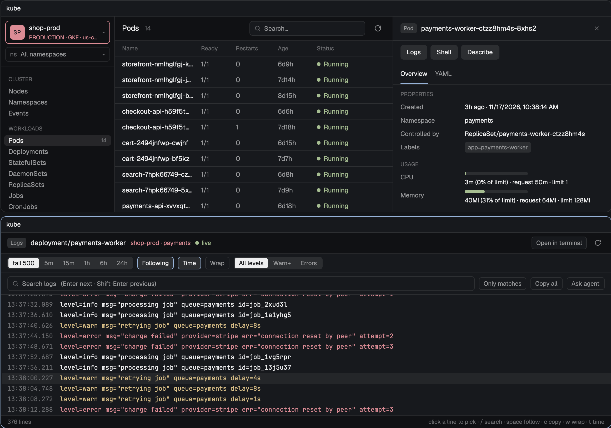

# Kubernetes

An OpenLens-style Kubernetes panel in a Herdr tab: pick one or several clusters and a namespace on the left, browse 18 kinds of resources in a sortable table with live CPU and memory, open any object's details, usage, events and YAML on the right, and read logs in a searchable viewer pane. Shells, port-forwards and describe open as terminals below.

## What you see

The mod `kube` (`mod.json`: `{ "place": "none", "title": "Kubernetes" }`) draws one of two views. Theme tokens throughout (`background`, `chrome`, `surface`, `raised`, `popover`, `hover`, `selected`, `border`, `input`, `accent`, `solid`, `ansi1`-`ansi6`), so it follows the theme. Base text 12.5px.

**Cluster view**, left to right:

1. **Sidebar**, 216px (172px when the panel is under 760px), `chrome`, right border.
   - Cluster button, 44px: a 28px rounded badge with the cluster's initials (colour from `ansi4, ansi5, ansi6, ansi2, ansi3` by a hash of the name; `ansi1` for production), the title in semibold and a 10.5px subtitle (`GKE · <location>`, `Connect gateway · <location>`, `EKS · <region>`). Production: red border and `PRODUCTION · <subtitle>` in `ansi1`. Several clusters: `N clusters` and their names. Opens a 320px popover card of fixed height (up to 440px): a title, a 28px "Filter clusters…" field that takes the keyboard when it opens (Enter picks the first match), then a scrolling list with one 40px row per context: badge, title, subtitle, a red `PROD` tag, and an 18px tick box on the right.
   - Namespace button, 28px: `ns` in dim, then the namespace or `All namespaces`. A 260px popover card of fixed height (up to 420px): a "Filter namespaces…" field (Enter picks the first match), then a scrolling list of `All namespaces` and every namespace of the shown clusters, a ✓ on the current one.
   - Resource tree: 10.5px dim group titles `CLUSTER`, `WORKLOADS`, `CONFIG`, `NETWORK`, `STORAGE`; 26px rows, the selected one on `selected` with its row count on the right.
2. **Main**: a 46px header on `chrome` (kind title 14px semibold, the count or `N of M` while searching, a 220px search box, a refresh button that becomes a spinning ring while loading, and, on a docked copy, a 28px × "Hide panel"), then the table. Header row 30px, 11px dim titles, click to sort (▲▼). Rows 30px with a bottom border; the name column flexes; a status column has a 7px dot and text in `ansi2` (healthy), `ansi3` (in progress), `ansi1` (failing) or `dim` (finished). With several clusters a 120px `Cluster` column in each cluster's colour follows the name. Columns have a width at which they hide (e.g. Pods' Controlled by below 1080px). Pods add `CPU` and `Memory` (live, only when metrics-server answered); Nodes show CPU and Memory as % of allocatable when it did, capacity otherwise. Warnings for clusters that failed while others loaded sit above the table in `ansi3`.
3. **Details**, 44% of the space (380-620px) with a left border on `surface`; when the table would be under 380px wide the details replace it. Header: kind tag, name, the cluster when several are shown, close. Action buttons (28px, `raised`): Logs, Shell (pods), Describe, Restart, Scale. Scale shows a replicas field; Restart and Scale show a confirmation bar, red-bordered with `PRODUCTION · <cluster>` on production. Tabs `Overview` / `YAML`. Overview sections (10.5px uppercase dim titles, 112px label column): Properties (created, namespace, controlled by, labels as chips, annotations), Usage (120×6px meter turning `ansi3` above 75% and `ansi1` above 90%, with `used (N% of limit) · request · limit`), then per kind: Pod status and container cards (state, image, live use, requests/limits, last exit in `ansi3`, links Logs / Previous logs / Shell / Forward <port>), workload replicas and conditions and a Pods list, Job, CronJob, Service (ports with Forward), Ingress rules, ConfigMap data, Secret keys with sizes only, Node capacity/allocatable/conditions/taints, PVC, Event. Events last. YAML: a read-only YAML editor at 12px.
4. Errors with nothing loaded: a centred notice (`Your AWS SSO session has expired`, `No AWS credentials for this cluster`, `This cluster's AWS profile isn't set up`, or (`Your cluster sign-in has expired`, `kubectl can't find its sign-in helper`, `kubectl isn't installed`, `Can't reach the cluster`), the message in the terminal font, and buttons `Sign in with AWS SSO` or `Set up SSO` (AWS clusters), `Sign in with gcloud` (GKE), `Copy error`, `Retry`. For AWS, above the message: "This cluster signs in with AWS profile P (region · role R)" and a `Profile` picker (a 340px fixed-height popover card listing `~/.aws/config` profiles: name, `session S · account · role`, a `CLUSTER` tag on the cluster's own, an `SSO` (accent) or `KEYS` tag); a warning in `ansi3` when the pick isn't SSO or uses a different SSO session from the cluster's profile. While a sign-in runs: a spinner and "Waiting for the sign-in to finish… retrying every 5 s".

**Log viewer** (a kube pane whose props are `{ logs: { context, namespace, kind, name, selector, container, previous } }`), top to bottom:

1. 40px header on `chrome`: `Logs` tag, `pod/<name>` or `deployment/<name>` (`· <container>`), `<cluster> · <namespace>` (red on production), a dot and `live` (`ansi2`), `paused` or `previous container`, a spinner while reading, `Open in terminal`, reload.
2. Toolbar (wraps): range segments `tail 500`, `5m`, `15m`, `1h`, `6h`, `24h` (solid when chosen); chips `Following`/`Paused`, `Time`, `Wrap`; level segments `All levels`, `Warn+`, `Errors`.
3. Search row (wraps): search box (min 220px), `N/M` or `no match` with ↑ ↓ chips, `Only matches`, `N picked ✕`, `Copy all`/`Copy picked`, `Ask agent`. Ask agent opens a row on `surface`: `Ask about N picked lines` / `the last N shown lines`, a question field, `Send to new session`.
4. With more than one pod/container: 22px pills, one per source, coloured `#4fb3ff #ffaf5f #d787d7 #87d787 #af87ff #ff875f #00d7ff #ffd700 #ff5f87 #87d7af` in order, with line counts; a hidden one is at 45% opacity.
5. Lines in the terminal font at 12px, 18px line height: time `HH:MM:SS.mmm` (92px, dim), the source's short name (pod suffix/container, up to 150px, in its colour), the text (`ansi1` error, `ansi3` warn, `dim` debug). Unwrapped, each line stays on one row at full length and the area scrolls sideways (a scroll area as wide as the longest shown line, capped at 4,000 characters), with the virtual list scrolling up and down inside it. Matches tint the line `surface` and, unwrapped, highlight the word on `ansi3`; the current match is `hover` with an `ansi3` left edge; picked lines are `selected` with an `accent` left edge.
6. 24px footer: `N lines · M shown`, a read error in `ansi1`, key hints.

## How it behaves

- Not an agent mod: it shows no agent statuses.
- Choosing a cluster shows it alone; ticking adds or removes clusters (at least one stays). The selection, namespace (per cluster set) and kind are remembered per copy in `localStorage`.
- A copy whose layout block has props `{ "docked": true }` shows the × in its header; it runs `layout.hide` on that block's id (found by walking `layout()` for the kube block with `docked`). A copy in a tab never shows it.
- Lists are read straight from the API (`kubectl get --raw <path>?limit=250&continue=…`), page by page, with `managedFields` dropped: Herdr caps each `exec` at 8 MiB of output, and one pretty-printed `get -A -o json` passes that at about 370 pods.
- Lists refresh every 5 s while the copy is shown (docked in the layout and not hidden, or a kube pane in the shown tab), each cluster in parallel; a failing cluster keeps the others' rows. The table resets its scroll on any cluster, namespace or kind change.
- Clicking a row opens or closes its details; `↑ ↓ j k` move the selection; `l s d y r /` as in the README; `Esc` closes. Keys are ignored while a text field has focus.
- Sign-in: each context's kubeconfig user tells how it signs in (`authOf` on its `exec`: `aws eks get-token` or `aws-iam-authenticator` with `AWS_PROFILE`/`--profile`, `--region`, `--role`; or `gke-gcloud-auth-plugin`). botocore's messages ("Error loading SSO Token", "The SSO session associated with this profile has expired…", "Error when retrieving token from sso", "Unable to locate credentials", expired security tokens, "The config profile (P) could not be found") are AWS sign-in errors. A sign-in button opens `tab.new` with `aws sso login --profile P` or `gcloud auth login`, then retries every 5 s for 3 minutes until the cluster answers.
- Logs open as a kube pane split below the focused pane (a new tab when nothing is focused). Shell, Port-forward and Describe open terminals the same way: `kubectl exec -it … -- sh -c "bash or sh"`, `kubectl port-forward pod|svc/<name> <port>:<port>` (`:<port>` below 1024), `kubectl describe … | less -R`.
- Restart (`rollout restart`) and Scale (`scale --replicas=N`, 0-500) run on the object's own cluster after confirmation, then toast success or the error.
- The log viewer reads `kubectl logs --prefix --timestamps --ignore-errors --limit-bytes=8000000` with `--tail=500` or `--since=…`; a workload uses its selector (`-l`, `--all-containers`, `--max-log-requests=30`). Following re-reads every 2 s with `--since-time=<newest timestamp>`, skipping lines already shown; scrolling up pauses following. At most 20,000 lines are kept. Clicking a line picks or unpicks it. Copy writes `data/kube/clipboard.txt`, pipes it to `pbcopy`, `wl-copy` or `xclip`, deletes it and toasts. Ask agent starts a tab with the first installed agent from `knownAgents()` (Claude Code first), its task the question plus up to 300 lines (60 KB).

## Built from

- Files: `mods/kube/main.js` (the view class; cluster view; hands log panes to `LogPanel`), `logview.js` (`LogPanel`), `kube.js` (kubectl, kinds and columns, formatting, metrics, YAML), `logs.js` (log args, parsing, levels, merge, filters), `demo.js` (made-up clusters), `icons/` (`search`, `refresh`, `spinner`, `close`, `kube`).
- Demo: props `{ demo: true }` (or `{ demo: { context } }` to start on one) lists the contexts `demo:gke_acme_us-central1_shop-prod`, `demo:gke_acme_us-central1_shop-staging`, `demo:kind-dev` and `demo:arn:aws:eks:us-east-1:123456789012:cluster/payments-eks` (its reads fail with an SSO error, with a made-up `~/.aws/config` of five profiles); `kubectl()` answers any `demo:` context from `demo.js` (pods with one CrashLoopBackOff, deployments, nodes, services, events, metrics that drift every 5 s, JSON/logfmt/nginx log lines generated per timestamp so following works). Terminals toast instead of opening there.
- `herdr`: `exec`, `run` (`pane.split` with `argv` or `mod`/`props`, `tab.new`), `focused`, `panes`, `spaces`, `layout`, `props`, `notify`, `knownAgents`, `settings`, `theme`, `appHome`, `home`. `fs/promises` for the clipboard file.
- gpui-base: `v_virtual_list` (table and log lines, one `on_item_click` handler; row renderers have no handlers), `VirtualListScrollHandle` (follow, jump to match), `Scrollbar`, `Popover`, `InputState`/`Input`, `EditorState`/`Editor` (created once in `init`, refilled with `set_value`).
- kubectl runs as `/usr/bin/env PATH=<path> kubectl --context <ctx> --request-timeout=20s …`, where `<path>` adds the folder the interactive shell finds `gke-gcloud-auth-plugin` in, the usual Google Cloud SDK folders, `~/.local/bin`, `~/bin`, `~/.krew/bin`, Homebrew and `/usr/local/bin` to the app's `PATH`. Usage comes from `kubectl get --raw /apis/metrics.k8s.io/v1beta1/…`.

## Watch out

- Herdr runs programs with the login shell's `PATH`; kubectl's credential plugins (GKE's `gke-gcloud-auth-plugin`) are often only on the interactive one. Without the extra `PATH`, every call fails with "executable … not found", which is not an expired sign-in.
- Handlers inside a virtual list's row renderer throw and the row silently doesn't draw: use `on_item_click` on the list.
- `line_height(18)` is a multiplier; write `"18px"`. `flex_shrink` needs a value.
- `EditorState.new` can't run during render.
- A docked block needs `props: { docked: true }` to know it is docked: props are the only thing a copy is told about where it sits. Keep the block's id when adding them, or its saved width is lost.
- A mod copy isn't told which pane it is, and a docked copy has none: open terminals under `focused().pane`, and decide "shown" from the layout tree and the shown tab.
- `herdr-app check` renders only the cluster view's first frame; log panes and deferred rows must be tried in the app.
- A scroll area inside a popover needs a fixed height (`h`), not only `max_h`, or it never scrolls.
- Never read a list in one `exec`: page it (`rawList`). `kube/test/cap.test.mjs` fails any call over 8 MiB.
- Secrets are redacted in `list()` before they are kept; keep any new view of secrets downstream of that.
- Limits: 20,000 log lines, 8 MB per container per read, 30 pods per workload log, 300 lines to an agent, 12 events in the details.

## Done when

- `herdr-app check mods/kube` passes and `npm test` passes.
- `{ "demo": { "context": "demo:arn:aws:eks:us-east-1:123456789012:cluster/payments-eks" } }` shows "Your AWS SSO session has expired", profile `payments-admin` (session `acme`) and `Sign in with AWS SSO`.
- `{ "demo": true }` shows `shop-prod` in red with 14 pods, one `CrashLoopBackOff`, with CPU and Memory columns.
- `herdr-app do tab.new --name Kubernetes --mod kube` shows every kubeconfig context; pods of the current one list with status colours, and with metrics-server, CPU and Memory columns.
- Picking a namespace lists only its objects; ticking a second cluster adds its rows and a Cluster column.
- Clicking a pod opens its details with Usage meters, containers, events and YAML; a Secret's YAML shows `<hidden: N bytes>` values.
- Logs on a deployment opens a log pane with one pill per pod; new lines appear within a few seconds; search counts matches; picking lines and Copy puts them on the clipboard.
- Restart on a production cluster shows a red confirmation naming the cluster, and only runs after confirming.
- With an expired GKE sign-in the panel says so and offers `Sign in with gcloud`.
