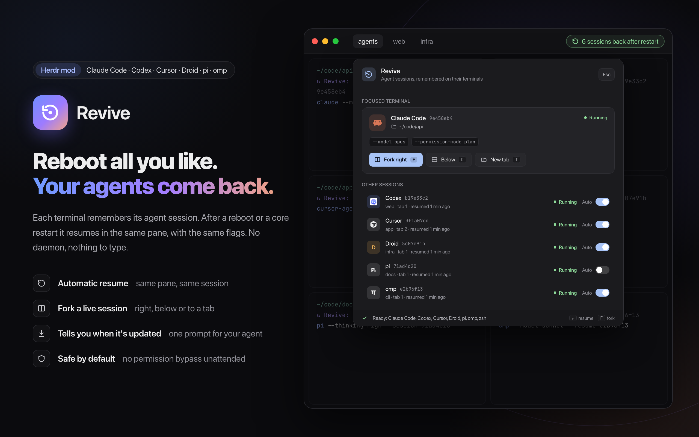

# Revive

Brings back the coding agent a Herdr terminal lost to a reboot or a herdr-core restart, in the same pane, with the same session and flags, and forks a live session beside it. Works with Claude Code, Codex, pi, oh-my-pi, Factory Droid, the Cursor CLI, GitHub Copilot CLI and, in this copy, **OpenCode**.

## Upstream

This is [herdr-revive](https://github.com/dmazlum/herdr-revive) by Devrim Mazlum, MIT ([license](../licenses/dmazlum-herdr-revive-MIT.txt)), at upstream commit `d61441d` (0.11.0 plus one later fix). This copy adds:

- **OpenCode.** A TUI plugin (`mods/revive/opencode/revive.js`) records the session the TUI shows, and Revive resumes it with `opencode --session <id>`. `revive.mjs install` puts it in `~/.config/opencode/herdr-revive/` and names it in `cli.json` (and `tui.jsonc` for OpenCode 1.x). It has no fork. `--auto` is left out of automatic resumes.
- **Flag values with control characters are refused**, so a label can't carry escapes into the text a manual Resume pastes.
- **The update check is off**: an upstream release would replace this copy, OpenCode and all. Upstream changes are merged here by hand.

## Install

Follow *Installing it* in [RECIPE.md](RECIPE.md): copy `mods/revive` to `~/.config/herdr-app/mods/`, check it, merge `keys.json` (`cmd-shift-r`), then run `node ~/.config/herdr-app/mods/revive/revive.mjs install`.

Revive runs `node` and `hc` on this machine, reads the agents' session files, and writes its hooks into their config files and your shell rc file (backed up once as `<file>.revive-backup`). With the update check off, it reaches no network.

## Tests

`cd revive && node --test test/*.test.js` (part of `make check`). `test/opencode.test.js` covers this copy's OpenCode support.
