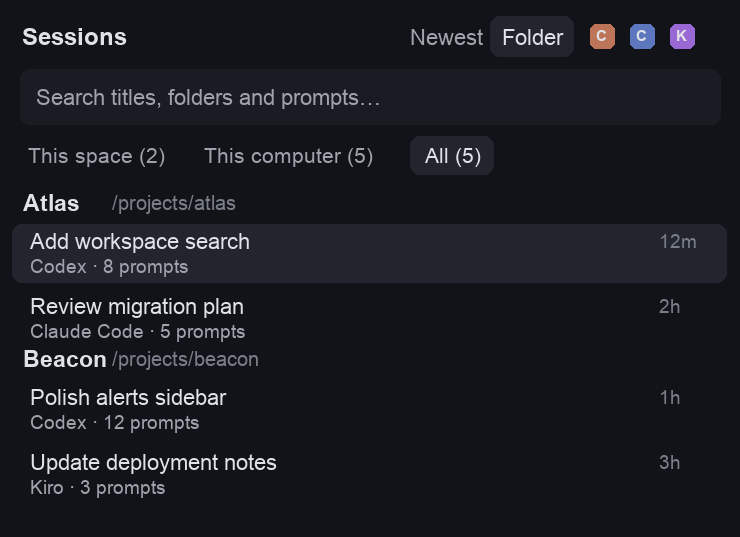

# Sessions

Search and reopen saved Claude Code, Codex and Kiro sessions from a side panel or popup. Sort by recency or group by folder.

## What you see

- A Sessions heading with **Newest** and **Folder** options, agent filters and refresh.
- A search box and scope chips for the current repository, current machine and all scanned machines.
- In Folder view, headings show the folder name and path. The All scope adds the remote machine name when applicable.
- Session rows have a title, agent icon, model, prompt count and age when available. Hover for the delete control.
- The optional tabs mod adds a 26px Sessions button. The shortcut opens a 460 × 600 popup.

## How it behaves

Newest shows one timeline. Folder groups by machine and full path, sorts groups alphabetically by folder name, and keeps the newest session first in each group. The sort choice is shared between the panel and popup. It applies to every scope and to search matches.

Click a row to resume its session. Shift-click forks where the agent supports it. Delete asks before permanently removing history. Refresh reloads data from this computer and connected non-temporary machines except names in `excludeMachines`.

## Built from

`mods/sessions/main.js` uses Herdr `shared` state for sort and runs the bundled `scan.py` via `exec` on each eligible machine. The scanner uses Python 3.9 or newer and reads Claude Code, Codex and Kiro history. It stores an incremental index and prompt excerpts under `~/.cache/herdr-sessions`. The shipped `config.json` starts with an empty exclusion list. The optional `sessions-tabs` block opens `sessions` in the layout's `panel-body` stack.

## Watch out

Display full paths to distinguish equal folder names. Keep group headers outside the session selection indexes so Up, Down and Enter target sessions. The list loads 50 rows at a time. Open-session detection depends on a session ID in a live terminal's arguments. Machine exclusions apply on the next refresh or reload.

## Done when

- Both mods pass `herdr-app check`. The popup opens with the configured shortcut.
- Folder shows grouping and newest-first sessions within each group. Newest restores the timeline.
- Changing scope or search preserves the selected order. A configured excluded machine supplies no rows and reports no scan error.
