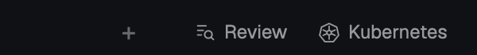

# Top bar actions

Two buttons at the right end of Herdr's tab bar: **Review** opens the [Redline](https://github.com/iampedii/herdr-redline) code review, and **Kubernetes** goes to this space's Kubernetes tab (the [kube](../kube) mod), opening one if there is none.



## Install

Tell your Herdr agent:

> Read ~/.config/herdr-app/AGENTS.md, then add this mod: https://github.com/jchen0824/herdr-mods/tree/main/topbar-actions

By hand:

1. Copy `mods/topbar-actions` into `~/.config/herdr-app/mods/`.
2. Clone the layout if you haven't: `herdr-app do layout.clone '{"name":"main","as":"my-main"}'`.
3. In `layouts/my-main.json`, wrap the `tabs` block in a row with this block after it (the row takes the `tabs` block's `size`, `resizable: false` and `window_drag: true`; the tabs block gets `"size": { "weight": 1 }`):

   ```json
   { "id": "topbar-actions", "type": "block", "size": { "px": 196 }, "content": { "mod": "topbar-actions" } }
   ```

4. `herdr-app check ~/.config/herdr-app/mods/topbar-actions`.

## Needs

- Review: the `redline` mod (`mod.open` toggles it). Without it, the button does nothing; delete its line in `main.js`.
- Kubernetes: the `kube` mod from this repo.

## Safety

No network, no programs, no files: it only runs Herdr commands (`mod.open`, `tab.select`, `tab.new`).

## License

MIT
