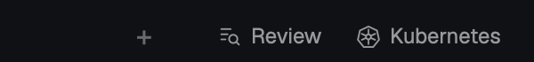

# Top bar actions

Two quiet buttons at the right end of the tab bar: Review opens the Redline code review, Kubernetes goes to the space's Kubernetes tab or opens one.

## What you see

A 184px block to the right of the tab bar (and of any other tab-bar buttons, such as skillshare's), the same height (42px in the `main` clone), on `chrome` with a 1px `border` bottom edge, contents left-aligned with 2px left and 10px right padding and 3px gaps, so the buttons sit next to whatever is on their left and the spare width falls at the window edge. Two buttons, each 26px high, 8px side padding, 6px corners, 12px text in `muted` with a 14px icon before it: `Review` (a list-and-magnifier icon, `review.svg`) and `Kubernetes` (a heptagon wheel, `kube.svg`). Icons are one-colour SVGs drawn with `svg()`, so they take the text colour.

## How it behaves

- Hover: background `hover`, text `foreground`.
- Review: `run("mod.open", { name: "redline" })`, which opens Redline's overlay, or closes it when open.
- Kubernetes: looks in the active space's tabs for a pane whose `mod` is `kube`; selects that tab (`tab.select { id }`), else `tab.new { name: "Kubernetes", mod: "kube" }`.
- Presses on the buttons stop propagation, so the surrounding `window_drag` row doesn't move the window; elsewhere in the block dragging moves it.
- No agent statuses.

## Built from

- `mods/topbar-actions/main.js` (one `View`), `mod.json` `{ "place": "none" }`, `review.svg`, `kube.svg`.
- Layout (a clone of `main`): the `tabs` block becomes `{ "id": "top-row", "type": "row", "size": { "px": 42 }, "resizable": false, "window_drag": true, "children": [ <tabs block with "size": { "weight": 1 }>, { "id": "topbar-actions", "type": "block", "size": { "px": 184 }, "content": { "mod": "topbar-actions" } } ] }`.
- `herdr`: `run`, `theme`, `spaces`, `panes`.

## Watch out

- Shipped layouts are read-only: clone `main` first.
- Right-aligning the buttons leaves a gap between them and a button on their left (skillshare's toggle is left-aligned in its own 118px block); left-align them and size the block to fit.
- Keep `window_drag` on the row, not the tabs block alone, or the space between tabs and buttons stops moving the window.
- Without the `redline` mod the Review button does nothing.

## Done when

- `herdr-app check mods/topbar-actions` passes.
- Both buttons sit at the right end of the tab bar, on the bar's colour, with the bar's bottom border running under them.
- Review opens and closes Redline; Kubernetes switches to an existing Kubernetes tab in this space, or opens one.
- Dragging the empty part of the block moves the window; pressing a button doesn't.
