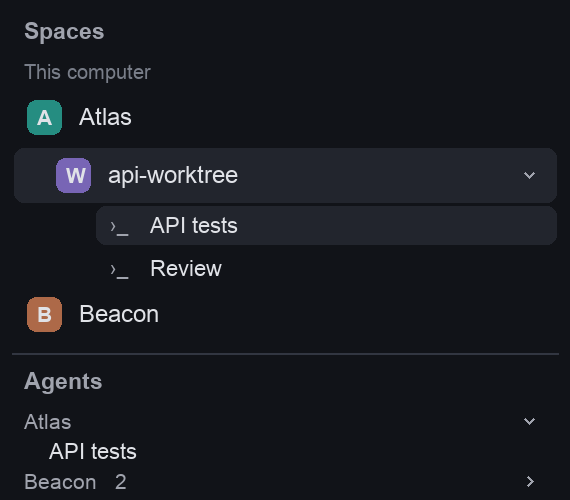

# Worktree Sidebar

Keep Spaces compact by showing tab lists only when you expand a linked Git worktree space. Fold each space's group independently in Agents.

## What you see

- Spaces keeps its machine groups, colored space avatars and branch information. A linked worktree has a 22px chevron control.
- Expanded worktree tabs appear as indented 25px rows. The active tab is highlighted.
- In Agents' **Grouped by space** view, a chevron appears on each header. A folded group shows its session count and the most urgent active status among its agents and sub-agents.

## How it behaves

Click a space row to switch spaces. Click a worktree's chevron to show or hide its tabs. Click a tab row to select it even if its space is currently inactive. Click an Agents group header to fold or unfold it. Spaces starts with worktree tab lists closed and Agents starts with groups open. Both panels save their choices independently.

## Built from

The `worktree-spaces` and `worktree-agents` mods adapt Herdr's shipped panels. Spaces uses its existing Git metadata to recognize a linked worktree, reads tabs from `spaces()`, and selects by ID with `tab.select`. Agents uses the grouped view's existing space IDs and keeps the fold state in local storage.

## Watch out

Use the full machine-qualified IDs from the app for remote spaces and tabs. The compact sidebar rail shows its existing icons. Worktree recognition depends on Git metadata being readable on the space's machine.

## Done when

- Both mods pass `herdr-app check`.
- Ordinary spaces remain single rows. A linked worktree expands independently and a tab row opens its tab.
- A grouped Agents header folds independently and its saved state survives a reload.
